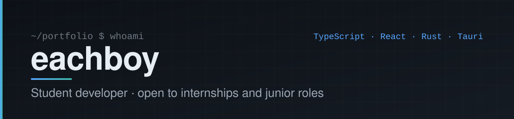

  

## Hi, I'm Timofey

I'm a student at Moscow Aviation University, building practical software projects and learning by shipping them. I'm looking for an internship or a junior position where I can work with a team, get code review, and grow.

## About

- Most of my hands-on work so far is a full desktop system for a local network: a TV display app plus an admin panel, written with TypeScript, Next.js and Rust.
- I like projects that cover the whole path: UI, local API, storage, CI and releases.
- I'm learning by building real tools and writing down how they work, so others can run them.

## Tech stack

Technologies used in my public project [TimetableForTvApp](https://github.com/eachboy/TimetableForTvApp).

**Languages**

**Frameworks and libraries**

**Data**

**Tooling**

## Featured projects

### [TimetableForTvApp](https://github.com/eachboy/TimetableForTvApp)

An offline timetable system for information screens in an educational institution. The TV app shows the weekly schedule, news and media; staff manage the content from a separate admin panel on any computer in the same local network.

- **TV app** (`frontend`): Next.js static export inside a Tauri 2 shell, with a built-in HTTP API written in Rust (axum) and an SQLite database, so no external server is needed.
- **Admin panel** (`admin-panel`): schedule editor with drag-and-drop, teachers, rooms, news, media, accounts, database export/import, and an update section.
- **Network layer:** automatic discovery of the TV via mDNS, an encrypted panel-to-TV channel (AES-256-GCM with HKDF-derived keys, replay protection), and signed auto-updates distributed over the LAN.
- **Engineering process:** CI on pull requests (type check, lint, Vitest, build, `cargo test`), release workflow on GitHub Actions, Dependabot, release notes drafted from PR labels, and a script that keeps versions consistent across files.

**Stack:** TypeScript, Next.js, React, Tailwind CSS, Tauri 2, Rust, SQLite, GitHub Actions

**What it shows:** designing a multi-component system, working across a TypeScript frontend and a Rust backend, and setting up tests, CI and a release process for it.

## Contact

- Website: [eachboy.site](https://eachboy.site)
